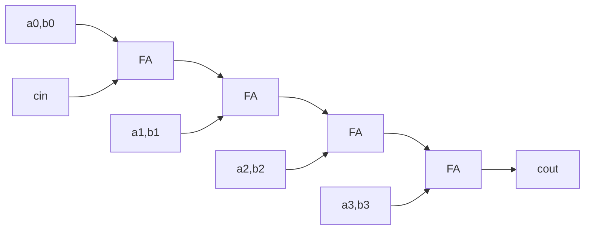

# FPGA Digital System Design Labs – Terasic DE2-115

Hands-on digital design labs written in **Verilog HDL**, synthesized with **Intel Quartus Prime 20.1 Lite**
and verified on real hardware: the **Terasic DE2-115** board (Cyclone IV E `EP4CE115F29C7`).

**Skills:** Verilog HDL · RTL design · Dataflow / Behavioral / Structural modeling · Hierarchical design ·
Pin assignment · FPGA synthesis & programming · Icarus Verilog

---

## Labs

| Lab | Topic | Status |
|-----|-------|--------|
| [Lab 1](lab1-combinational-circuits/) | Combinational circuits: half adder, full adder, 4-bit ripple-carry adder, 2:1 MUX | ✅ Done |
| Lab 2 | 7-segment decoder, ALU with flags, flip-flops, BCD counters / stopwatch, shift registers & LFSR, mixed Verilog/VHDL | 🚧 In progress |

---

## Lab 1 – Combinational Circuits

Each circuit is written in three modeling styles (dataflow, behavioral and gate-level structural),
then mapped to the board's switches (`SW`) and LEDs (`LEDR`, `LEDG`).

| File | Circuit | Board I/O |
|------|---------|-----------|
| [`lab1ex2.v`](lab1-combinational-circuits/lab1ex2.v) | Half adder | `SW[1]`, `SW[2]` → `LEDG[0]` sum, `LEDG[1]` carry |
| [`lab1ex3.v`](lab1-combinational-circuits/lab1ex3.v) | 1-bit full adder | `SW[2:0]` → `LEDG[0]` sum, `LEDG[1]` carry |
| [`lab1ex4.v`](lab1-combinational-circuits/lab1ex4.v) | 4-bit ripple-carry adder (4 × full adder) | `SW[3:0]` + `SW[7:4]` + `SW[8]` → `LEDG[4:0]` |
| [`lab1ex5.v`](lab1-combinational-circuits/lab1ex5.v) | 2-to-1 multiplexer | `SW[1]`, `SW[2]`, sel `SW[3]` → `LEDG[0]` |

### Demo

Exercise 2

https://github.com/user-attachments/assets/84079b33-508f-456c-b16e-ad72b182298f

<!--  -->
<!--  -->
<!--  -->

---

## How to run

1. Open `lab1-combinational-circuits/lab1.qpf` in Quartus Prime.
2. Choose the experiment: **Assignments → Settings → General → Top-level entity** (`lab1ex2` … `lab1ex5`).
3. **Processing → Start Compilation**.
4. **Tools → Programmer** → load `output_files/lab1.sof` → **Start**.

Pin assignments for the DE2-115 are included in `lab1.qsf`.

---

## Author

**Đậu Ngọc Đức** – Computer Engineering student, aspiring RTL Design & Verification Engineer
📧 Daungocduc2006@gmail.com
